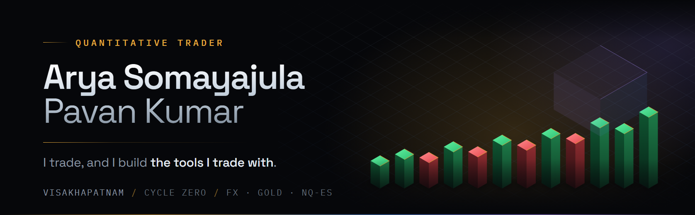

**I trade, and I build the tools I trade with.**

FX · Gold · US equities · Index futures — intraday and swing. No options.

[**Portfolio**](https://pavanarya24.github.io/track-record/) · [**Tape Lab**](https://tape-simulator-five.vercel.app/) · [**Cycle Zero**](https://cyclezero.freebuff.com) · [**LinkedIn**](https://linkedin.com/in/arya-somayajula-pavan-kumar-80b56236b) · [**Email**](mailto:aryapavan0369@gmail.com)

---

## What I do

Opening-range breakouts and 9 EMA / VWAP setups, filtered by order flow and dealer gamma exposure. Intraday and swing. Every idea is tested walk-forward and with Monte Carlo before it touches capital, and ideas that stop working get retired rather than defended.

**Top 7 of ~9,000 traders** — fastbull.com forex and gold competition, April 2025.

---

## What I build

### Tape Lab — market replay and execution training

A browser-native replay terminal. Step through OHLC bars one candle at a time, place simulated market / limit / stop orders against a documented fill model, and get graded on **process** — risk, execution, discipline — not on P&L. A profitable but sloppy replay scores *worse* than a flat, well-managed one.

An order-flow lab sits alongside it on a separate engine: delta, CVD, volume-at-price, spread, microprice, aggression, plus a top-10 DOM with imbalance, stacking, pulling and sweeps.

No backend, no broker, no live feed. It runs entirely in the browser.

`React 18` · `TypeScript` · `Vite` — **788 unit tests and 21 browser tests**, green in CI on every push.

**[Open Tape Lab →](https://tape-simulator-five.vercel.app/)** · **[Source](https://github.com/pavanarya24/Tape-Simulator)**

---

### Everything else

| | |
|---|---|
| **Research engine** | Hypothesis-driven platform with pre-registered experiments, walk-forward and Monte Carlo validation, data-integrity checks and a feature registry. |
| **Order-flow platform** | Tick-data pipeline on DuckDB — Lee-Ready trade classification, volume delta, footprint and cluster engines, with a PySide6 terminal. |
| **Prop-firm risk engine** | NQ/MNQ opening-range-breakout system with daily-loss, trailing-drawdown and position-sizing constraints, tested across a 432-configuration parameter sweep. |
| **Signal tooling** | XAUUSD signal terminal (Python / Streamlit), a Pine Script v6 candle-reversal model built as a finite-state machine, and a real-time WebSocket scanner for lead-lag cross-correlation across a ~200-stock universe. |
| **Reporting** | Parser for Fidelity trade confirmations with FIFO lot matching, for client P&L attribution. |

---

## Selected repositories

| Repository | What it is | |
|---|---|---|
| [**Tape-Simulator**](https://github.com/pavanarya24/Tape-Simulator) | Browser market-replay terminal and order-flow lab | [live ↗](https://tape-simulator-five.vercel.app/) |
| [**track-record**](https://github.com/pavanarya24/track-record) | Performance deck — the last 6 months | [live ↗](https://pavanarya24.github.io/track-record/) |
| [**fidelity-pnl-analyzer**](https://github.com/pavanarya24/fidelity-pnl-analyzer) | Fidelity confirmations → FIFO-matched P&L | |

---

## Stack

`Python` `pandas` `DuckDB` `TypeScript` `React` `Pine Script v6` `Streamlit` `PySide6` `WebSocket` `REST` `SQLite`

WebSocket and REST market data feeds, backtesting and walk-forward validation, tick-data pipelines.

---

## Open to

Quant trader roles, allocator conversations, and fintech collaborations. Email or LinkedIn is the fastest way to reach me.

<i>Nothing here is investment advice. Past performance does not guarantee future results.</i>

